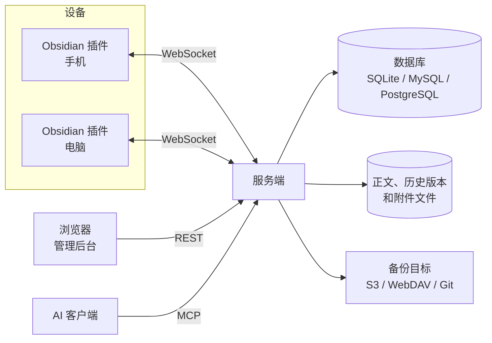

# Fast Note Sync：新人导览

> **30 秒版**：Fast Note Sync 是一套自己部署的 Obsidian 笔记同步系统。你在手机上改一篇笔记，电脑上的 Obsidian 几乎同时收到；同一份笔记库还能在浏览器里管理，也能让 AI 客户端通过 MCP 直接读写。它由三个代码仓库组成：服务端（本仓库，Go）、Obsidian 插件（TypeScript）和管理后台（React）。三个仓库都源自 HaierKeys 的上游项目。上游已经不再更新，现在它们是独立开发的仓库，不再跟上游。

## 愿景与思想

上游作者把多端同步做得很完整：笔记、附件、配置、文件夹都能实时同步，离线改动能合并，还有历史版本、回收站、分享、备份和 Git 推送。上游停止更新以后，我需要的新功能没人做了，所以 fork 过来自己往前走。这套系统的本体不变：笔记存在自己的服务器上，所有设备通过它保持一致。

我在 fork 里最主要的方向，是让笔记库直接对 AI 开放。服务端提供 MCP 接口，AI 客户端可以搜索、读取、修改笔记和附件，改动和手动编辑一样，实时推到所有在线的 Obsidian。管理后台有专门的接入页，用来创建只给 AI 用的令牌、测试连接。为了让这些改动能真正用上，fork 有自己的发行线：自己打 tag、发 Release、发 GHCR 镜像，后台的一键升级也只认这个 fork 的版本。

判断做得好，先看两件事：同步要快，任何一端的改动都尽快到达其他端；AI 能像我一样顺手地使用这个笔记库。快比稳更重要：两台设备改了同一篇笔记时，默认只留最新的一份，较旧的修改丢了就丢了，不为它拖慢同步。在此之上，需要什么就加什么，不预设边界。界面以后想改一改，现在够用。

## 组成

| 部分 | 一句话 | 什么时候读 | 文档 |
|---|---|---|---|
| 同步 | 插件和服务端之间的 WebSocket 同步：笔记、文件夹、Obsidian 配置文件、附件，以及合并和冲突 | 改同步消息、合并逻辑，或排查"改动没到另一端" | [同步](sync.md) |
| AI 接入（MCP） | AI 客户端通过 `/api/mcp` 读写笔记，后台有专门的接入页 | 加或改 MCP 工具、令牌权限、搜索 | [AI 接入](ai-access.md) |
| 笔记库与存储 | 笔记库、笔记、附件、历史版本、回收站、全文搜索的数据层 | 改表结构、查询，或数据相关的 bug | [笔记库与存储](storage.md) |
| REST API | 给脚本和外部程序用的 HTTP 接口，也是管理后台的后端 | 加或改 `/api` 下的接口 | [REST API](rest-api.md) |
| 账号与授权 | 用户、令牌、OIDC 登录、MCP 的 OAuth | 改登录方式、令牌权限 | [账号与授权](auth.md) |
| 分享 | 笔记分享链接、访问密码、短链接、访问统计 | 改分享页或分享权限 | [分享](share.md) |
| 备份、镜像与 Git | 定时归档到 S3、WebDAV 等，单向镜像，自动推送到 Git 远端 | 改备份任务或存储协议 | [备份、镜像与 Git](backup-git.md) |
| 发布与升级 | fork 的自有发行：tag、Release、GHCR 容器镜像、后台一键升级 | 发版本，或改升级逻辑 | [发布与升级](release.md) |
| Obsidian 插件 | 装在每台设备 Obsidian 里的同步客户端 | 改插件 | [插件仓库的 atlas](../../../obsidian-fast-note-sync/docs/atlas/README.md) |
| 管理后台 | 浏览器里的管理界面，构建后放进本仓库的 `frontend/` | 改后台页面 | [后台仓库的 atlas](../../../fast-note-sync-webgui/docs/atlas/README.md) |

## 你需要知道的术语

| 术语 | 白话解释 | 代码里叫 |
|---|---|---|
| 笔记库 | Obsidian 里的一个笔记文件夹。一个用户可以有多个笔记库。注意不要和代码仓库混淆 | `vault` |
| 内容哈希 | 笔记内容的指纹，用来判断两端内容是否相同 | `contentHash` |
| 基准哈希 | 这台设备上次同步成功时的内容哈希。服务端拿它判断"你改的是不是我手里这个版本" | `baseHash` |
| 离线同步策略 | 设备上传的笔记和服务端版本冲突时怎么办。名字里有"离线"，但只要基准哈希对不上就生效，两台设备同时在线编辑也一样。每台设备在插件里各自选：不合并只留最新、本地较新才合并、强制合并、手动合并 | `offlineSyncStrategy`：空、`newTimeMerge`、`ignoreTimeMerge`、`manualMerge` |

## 怎么配合

服务端是中心。每台设备上的插件和服务端保持一条 WebSocket 长连接，改动通过它上传，别的设备的改动也通过它推下来。管理后台和 AI 客户端不走长连接：后台调 REST 接口，AI 调 MCP 接口；它们写入的改动，同样由服务端推给在线的插件。数据库只存笔记的路径、哈希、时间这些元数据；笔记正文、历史版本和附件都存成文件。备份、镜像和 Git 推送是服务端的后台任务。

### 走一遍：手机上改一篇笔记，电脑上收到

1. **插件发现改动。** 你在手机上编辑 `日记/10-14.md`。插件监听 Obsidian 的文件事件，稍等片刻再处理，避免每敲一个字发一次（[events_manager.ts](../../../obsidian-fast-note-sync/src/lib/utils/events_manager.ts)）。
2. **插件上传。** 插件按文件的修改时间和大小查哈希缓存，缓存失效才读文件重算内容哈希。内容哈希和基准哈希相同，说明没变，不上传；不同，就把正文、两个哈希和修改时间打包成 `NoteModify` 消息发给服务端（[operator_note.ts](../../../obsidian-fast-note-sync/src/lib/sync/operator_note.ts)）。
3. **服务端判断能不能直接写。** 服务端查出这篇笔记的当前版本（[ws_note.go](../../internal/routers/websocket_router/ws_note.go)）。服务端版本就是手机的基准版本，说明中间没人改过，直接写；不是，说明别的设备也改过，按离线同步策略合并，或者把冲突退回给手机处理。
4. **写入。** 正文写成文件，元数据写进数据库（[note_service.go](../../internal/service/note_service.go)）。笔记之间的链接、Git 推送通知在后台异步处理；历史版本延迟几秒才生成，连续编辑只留一份（[task_note_history.go](../../internal/task/task_note_history.go)）。
5. **回执和广播。** 服务端给手机回 `NoteModifyAck`，手机这才把新的内容哈希记为基准。同时，服务端把新内容以 `NoteSyncModify` 推给同一用户的其他在线设备（[websocket.go](../../pkg/app/websocket.go)）。
6. **电脑写入。** 电脑上的插件收到推送，先检查这篇笔记本地有没有还没上传的改动。没有，就直接写进文件；有，就不覆盖，把服务端版本另存一份，标成冲突，等你处理（[operator_note.ts](../../../obsidian-fast-note-sync/src/lib/sync/operator_note.ts) 的 `receiveNoteSyncModify`）。

AI 通过 MCP 写笔记时，从第 4 步开始走同一条路：写入，然后推给所有在线设备。它不经过第 3 步的冲突判断，直接覆盖服务端版本。

## 文档地图

| 文档 | 在哪 | 给谁 | 活的 / 冻结 | 谁维护 |
|---|---|---|---|---|
| 项目介绍 | [README.md](../../README.md)，以及 [简中](../README.zh-CN.md) · [繁中](../README.zh-TW.md) · [日](../README.ja.md) · [韩](../README.ko.md) | 用户 | 活的 | 我 |
| 更新日志 | [en](../CHANGELOG.en.md) · [简中](../CHANGELOG.zh-CN.md) · [繁中](../CHANGELOG.zh-TW.md) · [日](../CHANGELOG.ja.md) · [韩](../CHANGELOG.ko.md)；写法见 [CHANGELOG_GUIDELINE.md](../CHANGELOG_GUIDELINE.md) | 用户 | 活的 | 上游 |
| 赞助名单 | [en](../Support.en.md) · [简中](../Support.zh-CN.md) · [繁中](../Support.zh-TW.md) · [日](../Support.ja.md) · [韩](../Support.ko.md) | 用户 | 活的 | 上游 |
| REST 接口 | [REST_API.md](../REST_API.md)、[swagger.yaml](../swagger.yaml)、[API-EXTENSIONS.md](../API-EXTENSIONS.md)、[admin_config_api.md](../admin_config_api.md) | 接口调用方 | 活的 | 我 |
| WebSocket 同步协议 | [SyncProtocol.md](../SyncProtocol.md)、[ws_api.md](../ws_api.md)、[websocket_integration.md](../websocket_integration.md)、[ws_setting_clear_api.md](../ws_setting_clear_api.md) | 客户端开发者 | 活的 | 我 |
| 运行手册 | [docs/runbook/](../runbook/)：OIDC、MCP 接入与工具、MCP OAuth、自有发行 | 部署和运维的人 | 活的 | 我 |
| MCP 使用技能 | [docs/skills/](../skills/) | AI 客户端 | 活的 | 我 |
| 飞牛 fnOS 打包 | [scripts/fnos/README.md](../../scripts/fnos/README.md) | 打包的人 | 活的 | 上游 |
| 一次 PR 的说明 | [PR-DESCRIPTION.md](../PR-DESCRIPTION.md) | — | 冻结 | — |
| 上游 issue | [haierkeys/fast-note-sync-service issues](https://github.com/haierkeys/fast-note-sync-service/issues) | 开发者 | 冻结，上游不再更新 | — |
