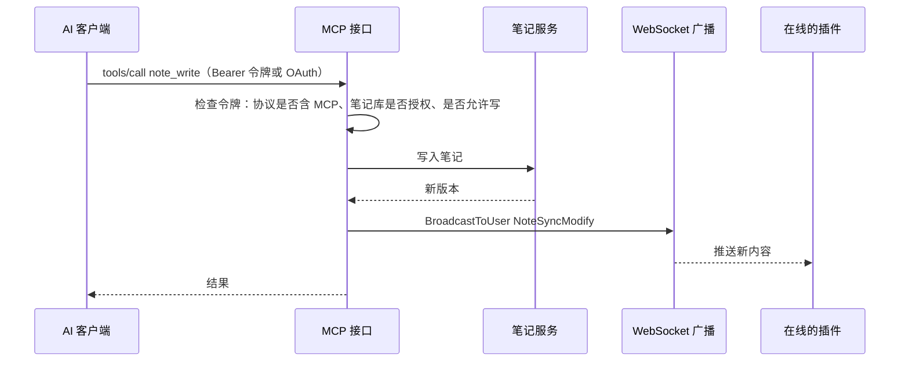

# AI 接入（MCP）

> **30 秒版**：服务端在 `/api/mcp` 提供 MCP 接口，Cherry Studio、Cursor、在线 Agent 这类 AI 客户端连上以后，可以搜索、读取、修改笔记和附件。AI 写入的改动和手动编辑一样，实时推给所有在线的 Obsidian。这是 fork 最主要的方向：让笔记库像对我一样，对 AI 也顺手。

## 边界

负责：MCP 协议的两种传输、工具定义和发现、工具的权限检查、跨笔记库搜索和它的索引；管理后台里的"MCP 接入"页（在[后台仓库](../../../fast-note-sync-webgui/docs/atlas/README.md)的 `src/components/mcp/`）。

不负责：令牌和 OAuth 本身怎么签发、怎么校验（见[账号与授权](auth.md)）；写入以后怎么推给设备（工具调用写入后，直接调用同步的广播，见[同步](sync.md)）；笔记的存储（见[笔记库与存储](storage.md)）。

## 怎么运转

1. **连接。** 两种传输：Streamable HTTP 走 `/api/mcp`，兼容旧客户端的 SSE 走 `/api/mcp/sse`（[router_mcp.go](../../internal/routers/router_mcp.go)）。请求先过 [mcp_oauth.go](../../internal/middleware/mcp_oauth.go)：带 Bearer 令牌的按 API 令牌校验，否则按 OAuth 校验。
2. **发现工具。** `tools/list` 只列合并后的 14 个工具（笔记读取、笔记修改、附件、回收站、笔记库）。旧工具还能调用，但不再出现在列表里，定义里标了 `deprecated` 和替代工具。工具清单和参数说明以运行手册 [mcp-tools](../runbook/mcp-tools.zh-CN.md) 为准，代码在 [consolidated_tools.go](../../internal/routers/mcp_router/consolidated_tools.go) 和 [discovery.go](../../internal/routers/mcp_router/discovery.go)。
3. **调用。** 每个工具先按令牌检查笔记库和读写权限，再调用和 REST、WebSocket 共用的服务层。写类工具成功后调用 `BroadcastToUser`，把改动推给这个用户所有在线设备（[note_tools.go](../../internal/routers/mcp_router/note_tools.go)）。
4. **搜索。** `note_search` 搜一个笔记库，`vault_search` 搜令牌能访问的所有笔记库，结果合并后统一排序分页。字面搜索用一个持久化的三字索引（表 `note_search_gram`）先挑候选，再用正文做最终确认；索引只负责缩小范围，正文才是准的（[note_search_repository.go](../../internal/dao/note_search_repository.go)）。
5. **后台接入页。** 任何登录用户都可以在后台为自己创建只给 AI 用的令牌：默认只读、只能走 MCP、30 天有效，可以限定笔记库；页面还能做一次连接测试（初始化加读取工具列表，不调用写工具）。用法见运行手册 [mcp-access](../runbook/mcp-access.zh-CN.md)；OAuth 部署见 [mcp-oauth-stytch](../runbook/mcp-oauth-stytch.zh-CN.md)。

给 AI 客户端看的使用说明在 [docs/skills/fns-mcp](../skills/fns-mcp/SKILL.md)。

## 为什么这样设计

- **工具合并成 14 个**：工具越多，AI 选错的概率越高，客户端的上下文也越占。旧工具保留可调用，已经写好的客户端配置不会坏。
  > 待确认：这条理由是我根据改动推断的。
- **搜索索引只当过滤器**：索引写失败或迁移中断时，那些笔记被标成"脏"，搜索时照样作为候选。所以索引出错只会变慢，不会漏结果。

## 坑

- **工具定义序列化失败时，HTTP 返回 200 但没有内容**，客户端看到的是"没有工具"，服务端日志也没有报错。→ 只检查内存里的工具列表发现不了。→ 改了工具定义，跑 [mcp_transport_test.go](../../internal/routers/mcp_router/mcp_transport_test.go)，它真的走一遍 HTTP 握手和 `tools/list`。修过一次，见提交 4cf8ffac。
- **后台和服务端不在同一个域名时，连接测试报网络错误**。→ 浏览器的跨域检查拦下了请求。→ 服务端要允许后台的 Origin，并暴露 MCP 的会话头。
- **MCP 写入不做冲突检查**。写类工具不带基准哈希，直接覆盖服务端版本。→ AI 和人同时改一篇笔记时，后写的覆盖先写的。→ 需要防覆盖时，让 AI 先读出版本号再写，并在工具里加版本校验。
- **只支持 OAuth、不能自定义请求头的客户端，用不了后台签发的 Bearer 令牌**。→ 这类客户端要走 OAuth。
- **`SearchCandidates` 返回空列表时，游标可能还不是零**。它每次最多扫 128 条候选，扫完不一定有命中。→ 服务层调用它时要按游标继续扫，不能看到空页就停。
