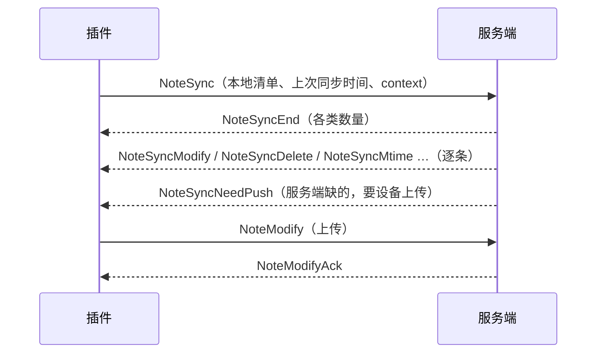

# 同步

> **30 秒版**：同步是插件和服务端之间的一条 WebSocket 长连接，上面跑一套"改动消息"协议。设备改了东西就发一条消息上来，服务端写入后推给同一用户的其他设备；设备重连时先做一轮全量比对，把离线期间的差异补齐。整个系统里最难的部分是冲突：两台设备改了同一篇笔记，服务端要决定合并、覆盖还是交给用户处理。

## 边界

负责：笔记、文件夹、Obsidian 配置文件（`.obsidian` 下的文件）、附件四类对象在设备和服务端之间的增量同步和全量比对；离线改动的合并与冲突；附件的分片上传下载。

不负责：笔记怎么存（见[笔记库与存储](storage.md)）；连接的身份验证（见[账号与授权](auth.md)）；插件这一端怎么监听文件、怎么写盘（见[插件仓库的 atlas](../../../obsidian-fast-note-sync/docs/atlas/README.md)）。

## 怎么运转

同步有两种节奏。

**实时改动**：设备改一个对象，发一条 `XxxModify` / `XxxDelete` / `XxxRename`；服务端处理后回 `XxxModifyAck` 等回执给发送方，再把 `XxxSyncModify` 等消息推给其他在线设备。根节点的[走查](README.md#走一遍手机上改一篇笔记电脑上收到)就是这条路。

**连接后的全量比对**：设备连上并通过验证后，对四类对象各发一次 `XxxSync`，带上本地清单和"上次同步时间"。服务端比对后先回一条 `XxxSyncEnd`，告诉设备一共要改、要删、要上传多少条；再逐条推送明细。清单很大时分批发送，每批要对方回 `XxxSyncPageAck`，同一批重发只补回执、不重复处理。

每次同步都带一个 `context` 标识，服务端在所有回包里原样带回，设备靠它把回包对上是哪一轮同步。协议细节见 [SyncProtocol.md](../SyncProtocol.md) 和 [ws_api.md](../ws_api.md)；消息名在 [action.go](../../internal/routers/websocket_router/action.go)，处理函数的注册在 [router_websocket.go](../../internal/routers/router_websocket.go)。

**冲突怎么判断。** 设备上传笔记时带两个哈希：内容哈希和基准哈希（这台设备上次同步成功时的内容）。服务端版本的哈希等于基准哈希，说明这期间只有这台设备改过，直接写。不等，说明别处也改过，按这台设备在插件里选的离线同步策略处理：

| 策略 | 服务端怎么做 |
|---|---|
| 不合并，保留最新 | 不合并，只留最后编辑的那一份；设备的版本较旧时，设备上的修改被丢弃 |
| 本地较新才合并 | 设备的修改时间更新时，以基准版本为共同祖先做三方合并；否则以服务端为准 |
| 强制合并 | 不看时间，直接三方合并 |
| 手动合并 | 不写入，回一条类型为 `NoteSyncNeedPush`、业务错误码为 530 的消息，带上服务端版本和基准版本，由插件弹窗让用户选 |

基准版本从[历史版本](storage.md)里按哈希找。找不到（例如历史还没来得及生成）时，用服务端当前内容当基准。合并实现在 [ws_note.go](../../internal/routers/websocket_router/ws_note.go) 和 [conflict_service.go](../../internal/service/conflict_service.go)。插件默认用第一种策略。

**插件这一端的冲突。** 上面是设备上传时服务端的判断。反方向也会冲突：服务端推下来一篇笔记，而这台设备上它还有没上传的改动。这时插件不覆盖本地文件，把服务端版本另存一份，列进冲突列表。用户在冲突列表里选好结果后，插件带着"已解决"标记重新上传，服务端直接写入，并推给所有设备，包括发送方。

**不经过冲突判断的写入。** MCP 的写类工具不带基准哈希，直接覆盖服务端版本（见 [AI 接入](ai-access.md)）。

**两种编码。** 消息默认是 JSON；连接时协商成功后可以用 Protobuf（[sync.proto](../../internal/proto/v1/sync.proto)，编解码钩子在 [protobuf_mapper.go](../../internal/routers/websocket_router/protobuf_mapper.go)）。附件的分片上传走二进制帧。

## 坑

- **写入成功或跳过写入的每一条分支都必须回 `NoteModifyAck`**，包括"内容没变、跳过写入"的分支（530 冲突分支回的是冲突消息，由插件的冲突流程处理）。→ 漏了的话，插件里这篇笔记一直挂在待确认列表里，每轮同步重新上传。→ 新增分支时检查回执；修过一次，见提交 235eac36。
- **并发写同一篇笔记时，不能用 singleflight 合并请求**。→ 两次不同内容的写入被当成一次，后一次的内容丢了。→ 同一篇笔记的写入用按 key 的互斥锁（`pkg/keyedmutex`）串行执行，每次都真正写一次，见提交 d9c1a328。
- **默认策略"不合并，保留最新"会丢掉较旧设备上的修改，设备上不提示**。→ 两台设备改了同一篇笔记，修改时间较早的那份没了。→ 这是有意的取舍：速度优先，见根节点的[愿景与思想](README.md#愿景与思想)。不要为了防丢把默认策略改成合并；个别设备在意时，在插件里自己改成合并或手动合并。
- **基准版本找不到时，用服务端当前内容当基准**。这时三方合并的结果就是设备的版本。→ 历史版本还没生成的那几秒里（默认 10 秒），另一台设备的改动会被覆盖。→ 不要把 `history-save-delay` 调长；两台设备同时编辑同一篇笔记，仍然有这个风险。
- **合并会让已删除的内容重新出现**。三方合并只看共同祖先，一端删掉的段落另一端还在，合并结果会保留它。→ 用户以为是 bug。→ 这是三方合并的固有行为，插件设置里的说明已经写了；不要为它在服务端加特判。
- **设备离线超过软删除保留期（默认 90 天，`soft-delete-retention-time`）**，服务端已经清掉删除记录。→ 设备重连后，会把别处早已删除的笔记当成新笔记重新上传。→ 插件有离线保护：离线超过 90 天时先拦下，问用户怎么办。插件里的 90 天是写死的，不读服务端配置；改了服务端的保留期，插件要一起改。
- **改 `sync.proto` 要两边一起改**。插件的 `pnpm proto` 脚本里，proto 文件路径写的是上游作者本机的路径，直接运行会失败。→ 先把路径改成指向本仓库的 `internal/proto/v1/sync.proto`。
- **协议有过一次不兼容升级**：消息分批传输上线后，插件必须 2.2.0 或以上。→ 再改协议时，在更新日志里写明最低插件版本。
